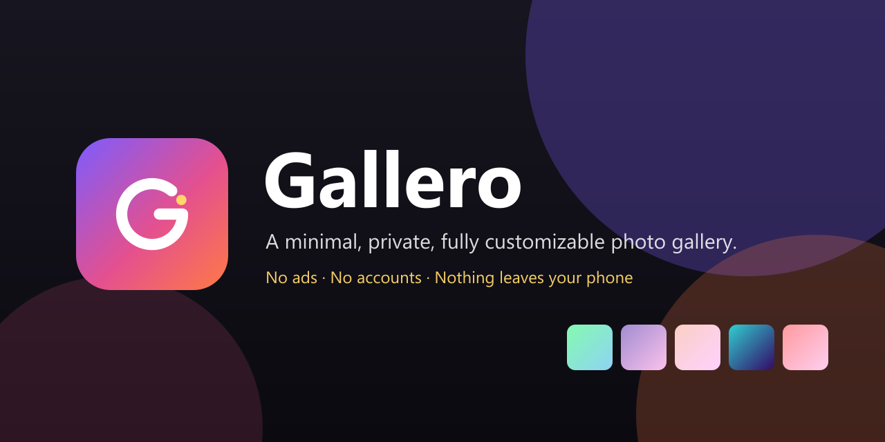
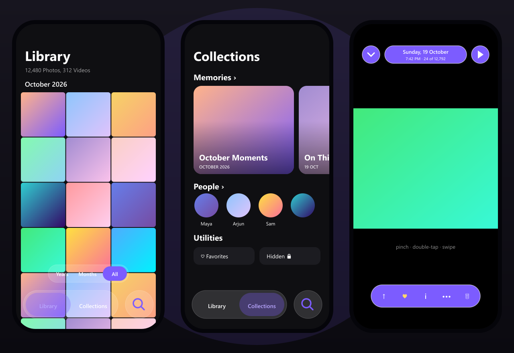

<p align="center">
  
</p>

<p align="center">
  <b>Your photos, beautifully simple.</b><br>
  No ads. No accounts. No cloud. Nothing leaves your phone.
</p>

<p align="center">
  
  
  
  
  
</p>

---

## Why I built Gallero

I got tired of my gallery apps.

The stock gallery on my phone was laggy with a big library. The popular third-party
galleries were full of ads, upsells and "premium" pop-ups. Google Photos is great at
backup, but it wants an account, wants to upload everything, and gives you almost no
say in how it looks.

I just wanted to **look at my own photos** — fast, beautiful, private, and arranged the
way *I* like. iPhone users get Apple Photos: People, Memories, a locked Hidden album,
Recently Deleted, that buttery zoom. On Android, that experience is scattered across
apps that all want something from you.

So I built **Gallero**: an Apple Photos–inspired gallery for Android that runs entirely
on the device, with no ads, no sign-in and no servers — and that you can restyle down to
the corner radius of a thumbnail.

## What makes it different

| | Typical gallery apps | **Gallero** |
|---|---|---|
| Ads / upsells | Common | **None, ever** |
| Account / cloud upload | Often required | **Not needed — fully offline** |
| Face grouping (People) | Usually cloud-based | **On-device ML** (ML Kit + MobileFaceNet) |
| Hidden & Recently Deleted | Often unlocked or missing | **Locked with fingerprint / face / PIN / pattern** |
| Look & feel | Fixed | **Themes, accent colours, fonts, grid density, corners, grouping…** |
| Slow phones | Same heavy UI for everyone | **Adapts** blur, animation and memory use to the device |

## Features

### Library

- Years · Months · All views, with big cover cards for each year and month
- Pinch the grid to change density (2–6 columns) with live feedback
- Long-press to select, then **drag across photos to select a range** (auto-scrolls)
- "Select all" per day/month, paste images straight from the clipboard

### Collections (Apple Photos–style, every section collapsible)

- **Memories** — On This Day, busy months, Year in Review, named people; one-tap *Play Memory* slideshow
- **Pinned** — Favorites, Videos, Screenshots, plus any album you pin
- **Albums**, **Featured Photos**, **Recent Days**
- **People** — faces detected and grouped on-device; name people, merge duplicates
- **Media Types** — Videos, Selfies, Screenshots, Panoramas, Animated, Screen Recordings
- **Utilities** — Favorites, Duplicates, 🔒 Hidden, 🔒 Recently Deleted

### Viewer

- Opens with a zoom out of the thumbnail and flies back on close
- Native swipe between photos; pinch to zoom around your fingers; double-tap to zoom
- Pan with momentum and soft edges; lift a finger mid-pinch and keep panning
- Swipe down to dismiss — the photo shrinks and the grid shows through
- Video playback with scrubber, info sheet (resolution, date, location, path), slideshow
- Share, favourite, copy to clipboard, copy/move to album, hide, delete

### Privacy & safety

- **Hidden** and **Recently Deleted** open only after biometric / screen-lock verification and re-lock when you leave
- Deleted items are kept privately for **30 days** and can be restored
- Face data never leaves the phone

### Search

- By month, year, weekday, album, file name, person, or "video / screenshot / selfie"

### Studio (customization)

- Themes: System, Light, Dark, AMOLED, Paper · 10 accent colours · 4 typefaces
- Grid columns, spacing, corner style (sharp → circle), grouping, sort order
- Glass effects (Auto / On / Off), haptics, large titles, video badges, black viewer

## Design

<p align="center">
  
</p>

<sub>Illustrations are generated from code (`scripts/generate-readme-art.mjs`) with abstract
gradient tiles — no real photos are used anywhere in this repository.</sub>

The brand is an open **G** with a warm sun in its gap, on a violet → pink → orange
gradient. All icons (app icon, adaptive & monochrome Android icons, splash, favicon) are
generated from one script: `npm run icons`.

## Performance

Gallero checks the phone once at startup (Android version, RAM, device class) and tunes itself:

- **Real backdrop blur** only on Android 12+ where it's cheap; a frosted tint elsewhere
- **Viewer gestures** run on the UI thread (Reanimated worklets, synchronous UI props) with
  layout-free transforms, so zoom and pan don't wait on JavaScript
- **Library index** loads the first screenful immediately and the rest in the background
- **People scanning** throttles itself by device memory and pauses whenever the app is in the background
- Fewer photos kept decoded in the viewer on low-RAM phones
- **Small download: ~23 MB APK** — ML Kit comes from Google Play services instead of being bundled, the face model is 8-bit quantized (1.5 MB), and code/resources are shrunk with R8

## Tech stack

- [Expo SDK 58](https://docs.expo.dev) · React Native 0.88 (New Architecture) · TypeScript
- Expo Router · Reanimated 4 · Gesture Handler 3 · FlashList 2 · expo-image
- expo-media-library · expo-local-authentication · expo-blur · expo-video
- On-device ML: Google ML Kit face detection (small local Expo module in `modules/gallero-faces`)
  plus MobileFaceNet embeddings via `react-native-fast-tflite`
- Jest (`jest-expo`) for unit tests

## Getting started

Requirements: Node 20+, JDK 17+, Android SDK, a phone with USB debugging (or an emulator).

```bash
npm install
npm run android        # dev build on a connected device
npm test               # unit tests
npm run typecheck      # TypeScript
```

Release APK:

```bash
npx expo prebuild --platform android
cd android && ./gradlew assembleRelease -PreactNativeArchitectures=arm64-v8a
# → android/app/build/outputs/apk/release/app-release.apk
```

> **Windows note:** the native C++ build can exceed Windows' path-length limit. If it fails
> with `ninja: error: mkdir(...)`, point Gradle at CMake 4.x (it bundles a long-path-aware
> ninja) in `android/local.properties`:
> `cmake.dir=C:/Users/<you>/AppData/Local/Android/Sdk/cmake/4.0.2`, or build from a short path.

The default release build is signed with the debug key. Use your own keystore (or EAS Build)
before publishing to the Play Store.

## Project structure

```text
src/app/                 screens (Expo Router)
  (tabs)/                Library · Collections + floating glass tab bar & search
  viewer.tsx             full-screen viewer (native pager, zoom, dismiss)
  search.tsx, people.tsx, person/[id].tsx, memory/[id].tsx, day/[key].tsx,
  media/[type].tsx, album/[id].tsx, albums.tsx, favorites.tsx,
  hidden.tsx, deleted.tsx, duplicates.tsx, settings.tsx (Studio)
src/components/          MediaGrid, Glass, Sheet, LockGate, FaceAvatar, UI kit
src/lib/                 library index, vault (hidden/trash/lock), people, memories,
                         settings, themes, device perf tiers, pure utils (+ tests)
modules/gallero-faces/   local Expo module: ML Kit face detection (Android)
assets/models/           MobileFaceNet (TFLite) + provenance
scripts/                 icon & README art generators
docs/                    QA report, LinkedIn post, images
```

## Testing & QA

- **30 unit tests** cover grouping, dates, duplicate detection, media-type rules, search,
  face matching, Recently Deleted retention and viewer geometry — `npm test`
- TypeScript strict mode — `npm run typecheck`
- Full results, manual device QA and known issues: **[docs/QA_REPORT.md](docs/QA_REPORT.md)**

## The story (LinkedIn post)

The launch post is in **[docs/LINKEDIN_POST.md](docs/LINKEDIN_POST.md)**. Short version:

> I got tired of gallery apps that lag, show ads, or want my photos in their cloud. So I
> built my own: **Gallero** — an Apple Photos–style gallery for Android that runs 100% on
> the device. People recognition, Memories, a locked Hidden album, Recently Deleted,
> buttery zoom, and a Studio to restyle everything. No ads. No account. No upload.

## License

**Source-available, all rights reserved.** You may view the code and use the app for
personal purposes, but you may **not** copy, modify, redistribute or reuse the source code
(in whole or in part) without written permission. See [LICENSE](LICENSE).

Third-party components keep their own licenses — see
[THIRD_PARTY_NOTICES.md](THIRD_PARTY_NOTICES.md) (including MobileFaceNet, Apache-2.0).
